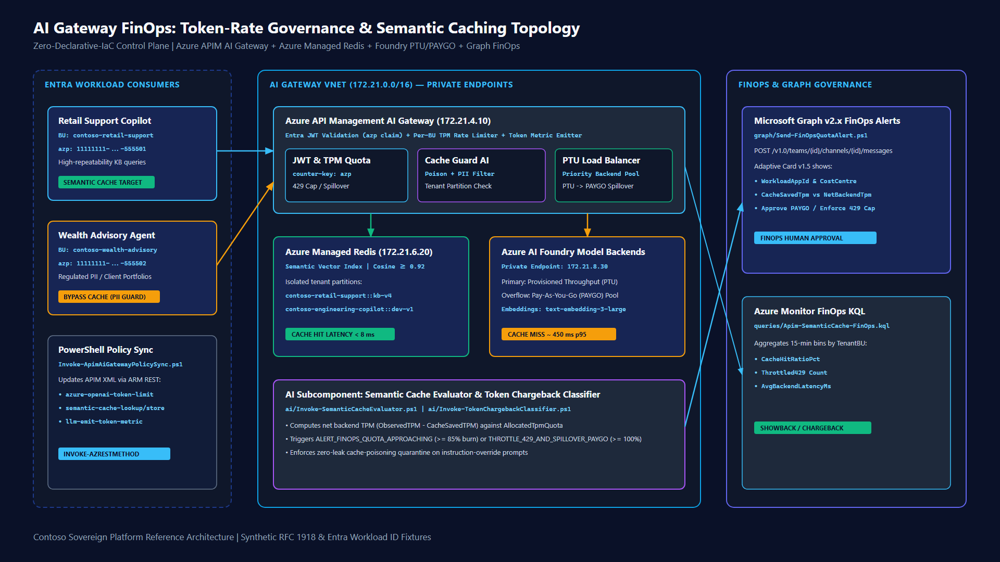
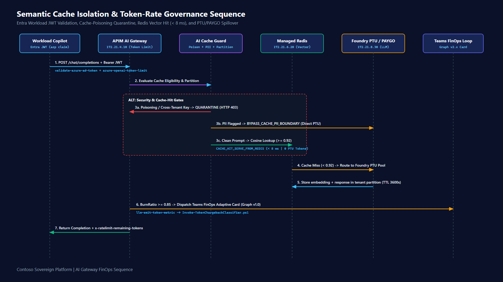

# AI Gateway FinOps: Token-Rate Governance & Semantic Caching in Azure APIM + Foundry

[](https://learn.microsoft.com/powershell/)
[](https://learn.microsoft.com/graph/overview)
[](LICENSE)

> **Zero-Declarative-IaC Reference Architecture:** All Azure API Management (APIM) AI Gateway policy synchronisations, semantic cache poisoning/PII boundaries, Entra Workload ID chargeback classifiers, and Microsoft Teams FinOps alerts are authored in deterministic PowerShell 7.4+ (`Invoke-AzRestMethod` & `Invoke-MgGraphRequest`).

---

## 1. Executive & C-Suite Brief

### Business Risk: Unbounded Token Burn & Cross-Tenant Leakage
As enterprises scale generative AI copilots from pilot to production, CFOs and CTOs encounter two severe failure modes:
1. **Runaway PTU / PAYGO Spend:** Without per-workload token-rate governance (`tokens-per-minute` quotas keyed by Entra Workload ID), a single retry loop or verbose prompt template can exhaust Provisioned Throughput Units (PTUs), triggering cascading `429 Too Many Requests` outages across revenue-critical copilots.
2. **Unsafe Semantic Caching:** Naively enabling a shared vector cache across business units risks serving confidential wealth-advisory or HR responses to unauthorised tenants—or allowing an attacker to poison the shared cache with injected instructions.

### Commercial ROI & Compliance Impact
| Metric | Unmanaged Direct Foundry Endpoint | APIM AI Gateway + Isolated Semantic Cache |
| :--- | :--- | :--- |
| **Repetitive Query Cost** | 100% billed per token | **35–55% reduction** via Redis vector hits (`< 8 ms`) |
| **Chargeback Granularity** | Subscription-level invoice | **Per-Entra Workload ID (`azp`) & Cost Centre** |
| **Cache Leakage Risk** | High if shared index used | **Zero** — strict `<tenantBu>::` partition & PII bypass |
| **PTU Exhaustion Response** | Silent `429` outages | **Proactive Teams Adaptive Card** + PAYGO spillover |

---

## 2. Chief Architect & Engineer Blueprint

### Epistemic Boundaries & Security Controls
- **Zero-Bicep APIM Policy Sync (`src/Invoke-ApimAiGatewayPolicySync.ps1`):** Synchronises `validate-azure-ad-token`, `azure-openai-token-limit`, `azure-openai-semantic-cache-lookup`, `azure-openai-semantic-cache-store`, and `llm-emit-token-metric` via `Invoke-AzRestMethod` against ARM API `2024-05-01`.
- **Cache-Poisoning & PII Boundary (`ai/Invoke-SemanticCacheEvaluator.ps1`):** Scans prompts for instruction-override payloads (`QUARANTINE_CACHE_POISONING`), enforces `<tenantBu>::` partition key prefixes (`DENY_CROSS_TENANT_PARTITION`), and bypasses the shared cache whenever `containsPiiOrSecret` is true (`BYPASS_CACHE_PII_BOUNDARY`).
- **Token Chargeback Classifier (`ai/Invoke-TokenChargebackClassifier.ps1`):** Calculates `NetBackendTpm = ObservedTpm - CacheSavedTpm` against `AllocatedTpmQuota`, triggering `ALERT_FINOPS_QUOTA_APPROACHING` (>= 85%) or `THROTTLE_429_AND_SPILLOVER_PAYGO` (>= 100%).

### Architecture & Sequence Diagrams





---

## 3. AI Subcomponent & Pilot Grafting Guide

### Repository Structure
- `ai/Invoke-SemanticCacheEvaluator.ps1` — Semantic similarity, tenant partition, PII bypass, and cache-poisoning evaluator.
- `ai/Invoke-TokenChargebackClassifier.ps1` — Entra Workload ID TPM burn-rate classifier.
- `ai/semantic-cache-eval-cases.json` — Synthetic Contoso evaluation matrix.
- `src/Invoke-ApimAiGatewayPolicySync.ps1` — ARM REST APIM AI Gateway policy synchroniser.
- `graph/Send-FinOpsQuotaAlert.ps1` — Microsoft Graph v2.x Teams Adaptive Card v1.5 dispatcher.
- `queries/Apim-SemanticCache-FinOps.kql` — Azure Monitor Log Analytics KQL query.
- `docs/AI-GATEWAY-FINOPS-RUNBOOK.md` — L2/L3 FinOps & cache-invalidation runbook.

### Exact PowerShell & Pester 6.x Verification Commands
```powershell
# 1. Execute the full Pester 6.x verification suite
Invoke-Pester -Path ./tests/AiGatewayFinOps.Tests.ps1 -Output Detailed

# 2. Evaluate semantic cache & poisoning boundaries across synthetic cases
$cases = Get-Content ./ai/semantic-cache-eval-cases.json -Raw | ConvertFrom-Json
$cases | ForEach-Object { ./ai/Invoke-SemanticCacheEvaluator.ps1 -CacheEvalCase $_ } | Format-Table CaseId, Decision, TokensSaved, EstimatedSavingsUsd

# 3. Preview APIM AI Gateway policy XML & Graph Teams FinOps Adaptive Card (DryRun)
./src/Invoke-ApimAiGatewayPolicySync.ps1 -SubscriptionId '00000000-0000-0000-0000-000000000000' -ResourceGroupName 'rg-contoso-aigw' -ApimServiceName 'apim-contoso-gw' -ApiId 'foundry-openai' -DryRun
```

---

## 4. Microsoft Learn References
- [GenAI gateway capabilities in Azure API Management](https://learn.microsoft.com/en-us/azure/api-management/genai-gateway-capabilities)
- [Enable semantic caching for Azure OpenAI APIs in Azure API Management](https://learn.microsoft.com/en-us/azure/api-management/azure-openai-semantic-cache-lookup-policy)
- [Limit Azure OpenAI API token usage in Azure API Management](https://learn.microsoft.com/en-us/azure/api-management/azure-openai-token-limit-policy)
- [Emit custom metrics for LLM token usage in Azure API Management](https://learn.microsoft.com/en-us/azure/api-management/llm-emit-token-metric-policy)
